<p align="center">
  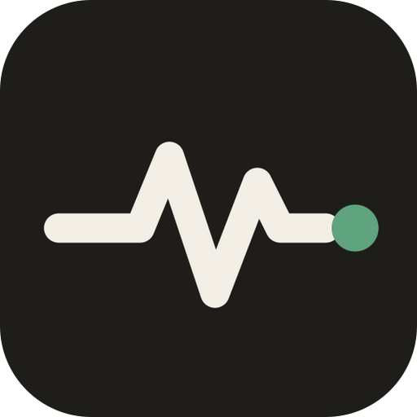
</p>

<h1 align="center">CrossRoads</h1>
<p align="center"><em>a decision moment</em></p>

<p align="center">
  <strong>Your body votes on your decisions.</strong><br>
  Imagine living each of two options while your camera reads your pulse, blinks and expressions,<br>
  then see, honestly, where your body reacted.
</p>

<p align="center">
  <a href="https://github.com/PawanBhandari03/smartspectra-challenge/actions/workflows/test.yml"></a>
  
  
  
  
  
</p>

<p align="center">
  <a href="https://github.com/PawanBhandari03/smartspectra-challenge/releases/latest"><strong>Download for Windows</strong></a> ·
  <a href="#-try-it-in-one-minute-no-camera-no-key"><strong>Try the sample (no camera)</strong></a> ·
  <strong>Demo video</strong> <em>(link added on release)</em> ·
  <strong>DEV post</strong> <em>(link added on release)</em>
</p>

> **TL;DR** · Stuck between two options? CrossRoads guides you through short scenes for each option, **twice, in a mirrored order (A B B A)**, while the [Presage SmartSpectra SDK](https://smartspectra.presagetech.com/) reads your pulse from your camera. It then shows a **mirror, not a verdict**: your pulse through the session, the moments your body reacted, and questions to reflect on. It names a "calmer" option **only when both rounds agree beyond normal pulse wobble**. We tested that rule against ourselves: a tea-vs-coffee control (it correctly said nothing) and a beach-vs-speech positive control (it found the calm option once, and on an identical repeat it honestly said it could not tell). Everything runs on your computer; video is never saved.

<p align="center">
  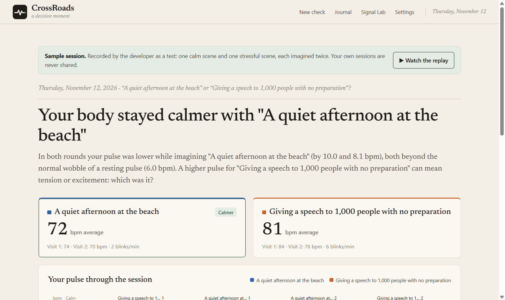
  <br><sub>A real check by the developer: the pulse was about 10 bpm lower in both rounds for one option. A mirror, not a verdict.</sub>
</p>

## Contents

[Try it in one minute](#-try-it-in-one-minute-no-camera-no-key) · [Download](#download) · [How it works](#how-it-works) · [Screenshots](#screenshots) · [How it uses the SDK](#how-it-responds-to-human-signals) · [Validation](#the-honest-part-we-tried-to-fool-our-own-app) · [Architecture](#architecture) · [Consent & data](#consent-and-data-handling) · [How judges can test](#how-judges-can-test) · [Run from source](#run-from-source) · [Troubleshooting](#troubleshooting) · [Limitations](#limitations) · [Judging criteria](#how-it-fits-the-judging-criteria-and-prize-categories) · [Docs](#documentation)

## ⏱ Try it in one minute (no camera, no key)

1. [Download](#download) and install CrossRoads (or [run from source](#run-from-source)).
2. On the home page click **Try the sample**.
   → *You should see:* "Your body stayed calmer with 'A quiet afternoon at the beach'", with the two options' pulse averages (72 vs 81 bpm).
3. Click **▶ Watch the replay**.
   → *You should see:* the recorded session play back at 5× speed: prompts, the four visits and live pulse/breathing/blink/expression tiles, then the same result again.

The sample is a real recording (numbers only, camera name removed). It replays on its own recorded timing, so it always shows its real result.

## Download

| System | File | Status |
|---|---|---|
| Windows 10/11 x64 | `CrossRoads-Setup-<version>.exe` (installer) | ✅ Built and tested installed |
| Windows 10/11 x64 | `CrossRoads-Portable-<version>.exe` (no install) | ✅ Built |
| macOS / Linux | — | ❌ Not built (the SDK supports them; [run from source](#run-from-source) is untested there) |

Download from [Releases](https://github.com/PawanBhandari03/smartspectra-challenge/releases/latest). The app is not code-signed, so Windows SmartScreen shows *"Windows protected your PC"*: click **More info → Run anyway**.

For live measurement you need a free Presage API key from [physiology.presagetech.com](https://physiology.presagetech.com): paste it in **Settings** (stored encrypted on your computer). The sample works without one, and the app tells you up front (with an **Open Settings** button) if a live check needs a key.

## How it works

1. **Name two options and consent**, on one page: e.g. "Stay in my city" and "Move to Bangalore", with the plain-language terms beside them.
2. **Camera check.** A free preview ticks off *Camera on → Smooth picture → Enough light → Ready* before anything is measured. **Hide me** blurs the preview (measurement is unaffected).
3. **The session (~4 minutes).** A calm baseline, then each option twice in a mirrored order. Every 10 seconds a new prompt helps you picture living that option ("a month in, how do your evenings feel?"), with a thin line of your live pulse underneath in that option's colour. Read silently and imagine.
4. **Your mirror.** The answer with an animated crossroads (the calmer path draws thicker; equal when there's no clear side), the numbers per visit, a connected pulse chart with each visit's average, the moments your pulse rose, and reflection questions. **Save as image** makes a shareable card with no pulse numbers on it.
5. **My decisions.** Every check is saved locally. Later you record what you actually decided; CrossRoads shows it as a "You decided" note and counts how often your choice matched the option your body was calmer with.

Light by default, with a dark "night journal" mode (moon button, or Settings → Appearance).

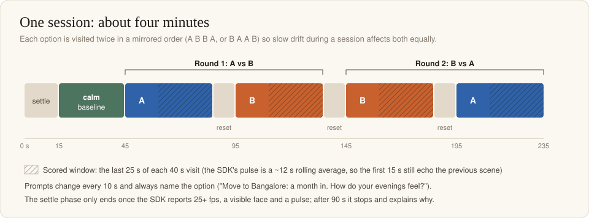

## Screenshots

| | |
|---|---|
| 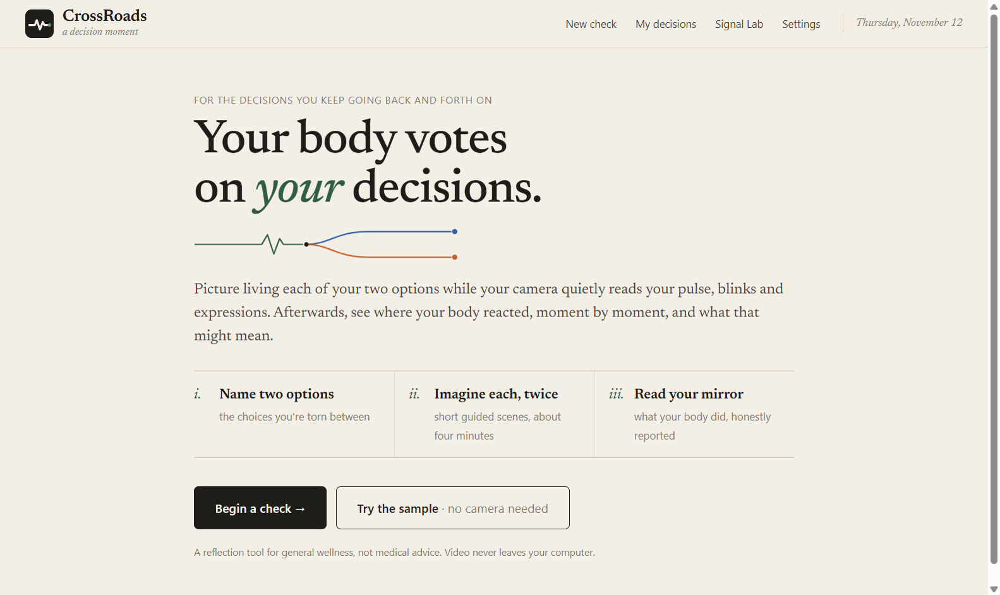<br><sub>Welcome: begin a check, or try the sample without a camera.</sub> | 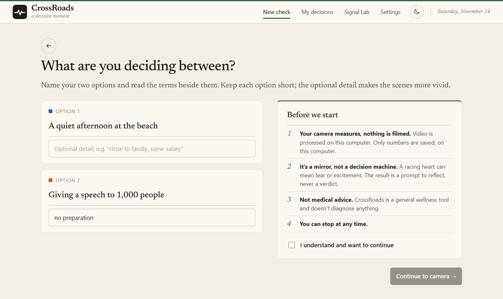<br><sub>Two options on one page, with the consent beside them.</sub> |
| 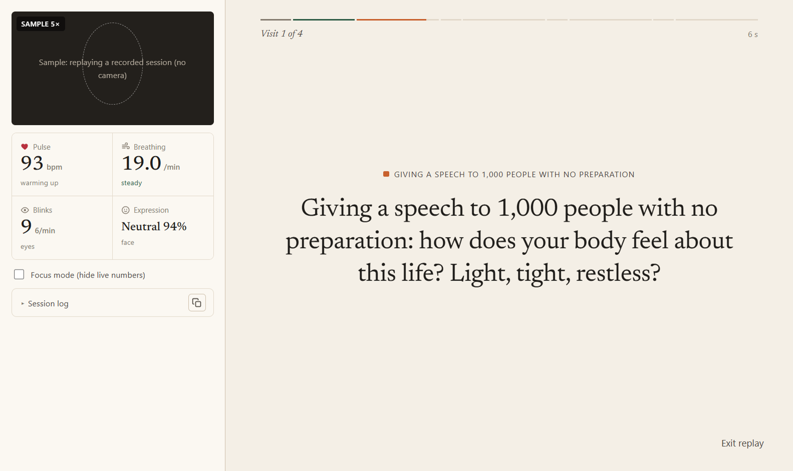<br><sub>During a session: live tiles, the prompt, and the live pulse line (it takes the colour of the option you are imagining). <em>Sample replay shown.</em></sub> | 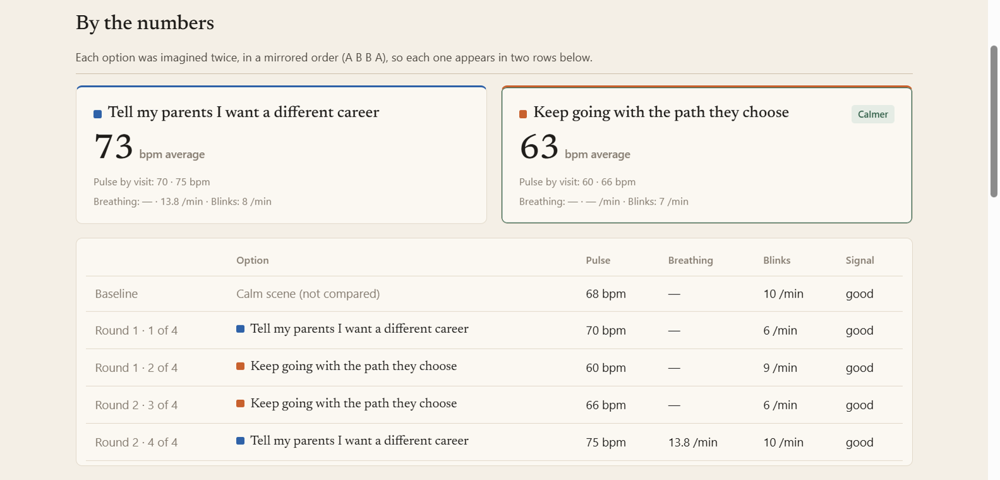<br><sub>By the numbers: each option's average, then every visit with its pulse, breathing, blinks and signal quality.</sub> |
| 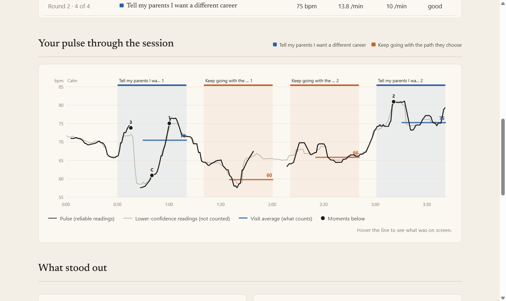<br><sub>Pulse through the session: reliable readings in black, lower-confidence ones faint, each visit's average in the option's colour. Hover to see the prompt at that moment.</sub> | 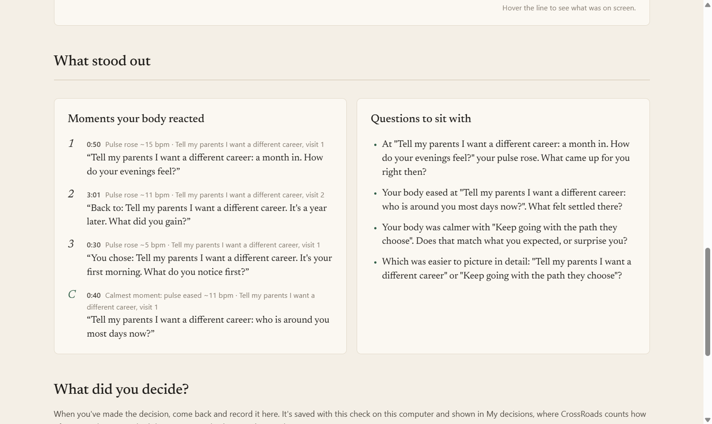<br><sub>Moments your body reacted, and questions to sit with.</sub> |
| 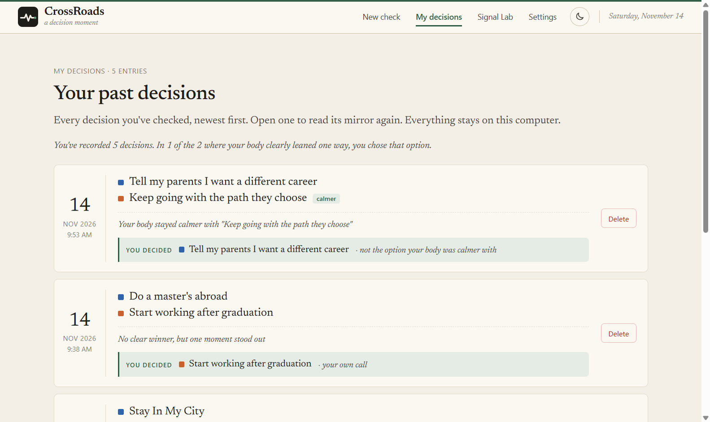<br><sub>My decisions: every check, what you decided, and how it compared with your body. Stored only on your computer.</sub> | 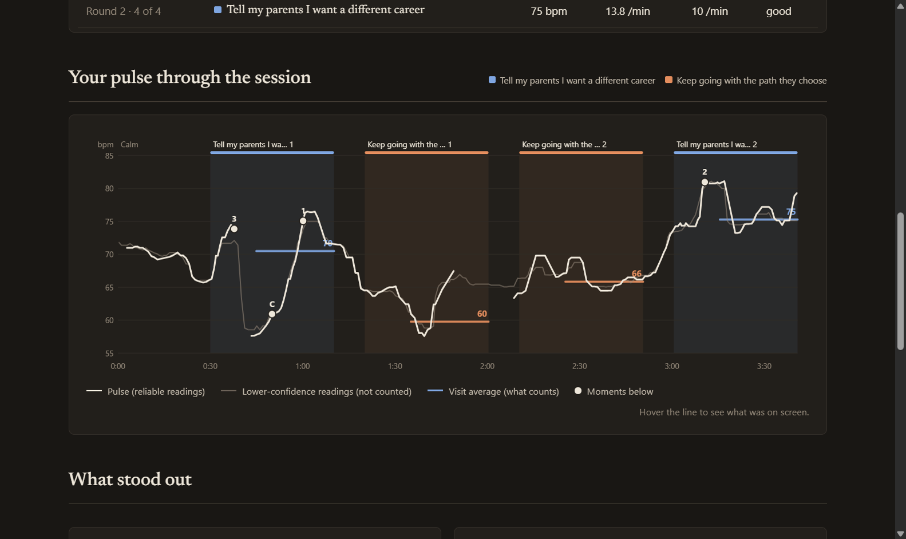<br><sub>Night-journal dark mode.</sub> |

## How it responds to human signals

| SDK signal | How CrossRoads uses it |
|---|---|
| **Pulse rate** (`PULSE_RATE`) | The basis of the comparison: per-visit medians of stable, confident readings; reaction moments; the live heart animation |
| **Breathing rate** + chest/abdomen traces | Shown live; not voted (30 s averaging is longer than the useful part of a visit) |
| **Blinking** | Live blink count and rate; blinks per visit in the details |
| **Expressions** | Live tile; not voted (they drifted with light and posture) |
| **HRV** (`HRV`) | Requested and recorded; not shown (never reached useful confidence in 4-minute sessions) |
| **Validation status** | Plain-language guidance ("Too dark. Add light in front of you.") and the settle gate |
| **Processing status / errors** | Session start (`kRunning`), safe stop on `kError`, partial results kept |
| **`videoOutput` frames** | A 320 px live preview while the SDK owns the camera |

The SDK runs in Electron's main process with native camera capture (`useCamera`, 1280×720 @ 30 fps) and telemetry off. Details and lessons learned: [docs/SDK-NOTES.md](docs/SDK-NOTES.md).

## The honest part: we tried to fool our own app

The first version compared each option once with a calm baseline. Our **tea-vs-coffee control** produced a *bigger* "difference" than a real life decision, and the second option always came out higher: drift, not preference. So CrossRoads now visits each option twice (A B B A), compares the options with each other, and only names a calmer option when **both rounds agree by more than max(visit wobble, 6 bpm)**. That threshold came from cutting real recordings into fake sessions: one-minute pulse blocks differ by 6–9 bpm by chance.

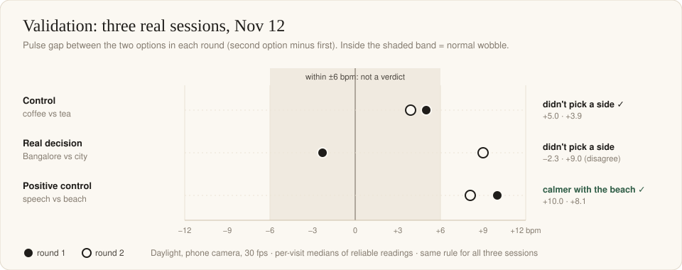

| Validation session (daylight) | CrossRoads said |
|---|---|
| Control: drink tea vs drink coffee | **Didn't pick a side** ✓ (a looser rule would have said "calmer with tea") |
| Real decision: stay in my city vs move to Bangalore | **Didn't pick a side** (the two rounds disagreed) |
| Positive control, run 1: a quiet afternoon at the beach vs giving a speech to 1,000 people with no preparation | **Calmer with the beach** ✓ (−10.0 and −8.1 bpm) |
| Positive control, run 2: the same two options again, ~8 hours later, better signal | **Didn't pick a side** (the rounds disagreed: speech +2.1, then −7.5 bpm) |
| Nov 14, final build: stay in my city vs move to Bangalore (again) | **Didn't pick a side** (70.0 vs 70.0 bpm) |
| Nov 14: do a master's abroad vs start working | **No clear winner**, but one moment stood out (+8.4 bpm at "what did you give up for it?") |
| Nov 14: tell my parents I want a different career vs keep going with the path they chose | **Calmer with "keep going"** (both rounds beyond 6 bpm; says nothing about which is right) |

The app never invented a winner when the evidence was weak or contradictory. Across seven sessions it named a calmer option twice and said "no clear winner" five times, and it found the beach reaction once but not on the repeat, so a clear reaction is not guaranteed in a four-minute session. Seven sessions from one person are not a study. Full numbers, the calibration and the limits: [docs/VALIDATION.md](docs/VALIDATION.md). Check the sample yourself with `npm run analyze`.

<details>
<summary><strong>How the verdict is decided</strong></summary>

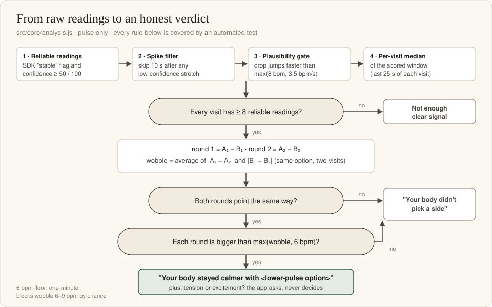

</details>

## Architecture

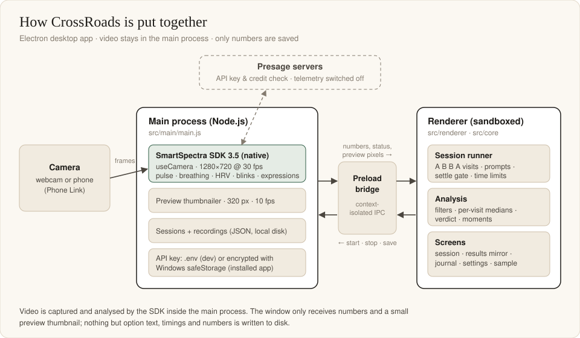

Main process (SDK, camera, storage, encrypted key) · context-isolated preload bridge · sandboxed renderer (session runner, analysis, screens). Module map, state machine, data formats, IPC surface, security model and design decisions: [docs/ARCHITECTURE.md](docs/ARCHITECTURE.md).

## Consent and data handling

- **Consent first.** Plain-language consent beside the two options, with an explicit tick before any measurement; a REC badge and live preview while measuring; stop any time.
- **Video never leaves the app.** The SDK processes frames on your computer. CrossRoads saves only your two options, phase timings and numbers (pulse, breathing, blinks, expression scores). Never video.
- **Stored locally only**: `%APPDATA%\crossroads` (installed app). No accounts, no analytics, no AI services, no other network requests by CrossRoads.
- **SDK network use:** according to Presage, the SDK contacts their servers to check the API key and credits. SDK telemetry is switched off. We have not measured the SDK's traffic ourselves.
- **Only what it needs:** CrossRoads asks the SDK for seven measurements (breathing, pulse, HRV, blinks, expressions) and nothing else; a test fails if that list grows.
- **Camera names stay private.** Windows names phone cameras after their owner; CrossRoads shows and logs them without the name.
- **Save as image** writes a picture only where you choose, and the card carries no pulse numbers. If you saved a decision, it adds a line "I chose: …".
- **Delete any time:** one session in My decisions, or everything in Settings → *Delete all my data*. The API key can be removed in Settings.
- **Not medical.** A general wellness reflection tool; no diagnosis, no treatment, no medical decisions. For reflecting on your own decisions only, never for measuring other people.

Full details: [docs/PRIVACY.md](docs/PRIVACY.md).

## How judges can test

**Path 1 · No camera, no key (1 minute)**
1. Install from [Releases](https://github.com/PawanBhandari03/smartspectra-challenge/releases/latest) (SmartScreen: *More info → Run anyway*).
2. **Try the sample** → *you should see "Your body stayed calmer with 'A quiet afternoon at the beach'"*.
3. **▶ Watch the replay** → *you should see the four visits play at 5× with moving live tiles, then the same result*.

**Path 2 · Live signals (2 minutes, ~1 Presage credit)**
1. **Settings** → paste your Presage API key → **Save key** → *status "Saved (encrypted on this computer)"*.
2. **Signal Lab** → pick your camera → **Open camera** → *"Measured: 25+ fps" in green* (if lower, add light in front of you).
3. Auto-stop **30 s** → **Start live test** → *pulse, breathing, blinks and expression fill in; it stops by itself and logs "Recording saved"*.

**Path 3 · A full check (5 minutes, ~8 credits)**
1. **Begin a check** → enter two options (try "A quiet afternoon at the beach" / "Giving a speech to 1,000 people with no preparation") → consent → pick your camera → **Begin session**.
2. Sit back, face the light, read the prompts silently and really imagine each scene → *settle, calm baseline, four visits, ~4 minutes*.
3. → *Your mirror: a headline, both options' pulse, the timeline, reaction moments and questions. The session appears in My decisions.*

## Run from source

Requirements: Windows 10/11 x64, Node.js 20+ (22 used), a webcam (a phone through Windows Phone Link works well).

```bash
git clone https://github.com/PawanBhandari03/smartspectra-challenge.git
cd smartspectra-challenge
npm install
cp .env.example .env    # then put PRESAGE_API_KEY=... in .env (or add the key in Settings)
npm start
```

| Command | What it does |
|---|---|
| `npm start` | Bundle the UI (esbuild) and launch the app |
| `npm test` | 47 automated tests (verdict rules, filters, session plan, SDK decoding, replay, result wording, requested metrics, private camera names) |
| `npm run analyze` | Print the full analysis of the bundled sample (or `npm run analyze -- path/to/session.json`) |
| `npm run dist` | Build the Windows installer and portable exe into `release/` |

## Tests

`npm test` runs 47 tests with Node's built-in runner, and GitHub Actions runs them on every push. They lock in the validation story: the bundled positive control must say "calmer with the beach", noise-only sessions must say "didn't pick a side", rounds that disagree must not produce a winner, low-confidence and spike readings must be ignored, the session plan must always be A B B A or B A A B, result wording must never call a choice wrong, and the SDK must only be asked for the seven measurements listed in the privacy notes. Manual tests with dates: [docs/MANUAL-TESTS.md](docs/MANUAL-TESTS.md).

## Troubleshooting

| Symptom | Cause and fix |
|---|---|
| "Windows protected your PC" | The app isn't code-signed. Click **More info → Run anyway**. |
| "Camera slow (fps < 25)" | Dim light makes webcams slow down. Face a window or lamp; avoid bright light behind you. A phone camera via Phone Link holds 30 fps. |
| Session stops: "couldn't get a steady signal in 90 seconds" | The settle gate needs 25+ fps, a visible face and a pulse. The message says which check failed. |
| "Not enough clear signal" result | Too few reliable pulse readings in a visit. Better front light and staying still fix it. |
| Live measurement disabled | No API key. Add it in **Settings** (installed app) or `.env` (from source). |
| Blinks appear a few seconds late with a phone camera | Phone Link buffers the video over Wi-Fi; the SDK itself reports blinks within ~30 ms. Results aren't affected. |
| `npm start` opens no window / `app is undefined` | `ELECTRON_RUN_AS_NODE` is set by some tools; `npm start` clears it. If Electron's binary is missing: `node node_modules/electron/install.js`. |

## Limitations

- **One person, seven validation sessions.** Not a study. The positive control was found once and not on the repeat.
- **Pulse wobbles 6–9 bpm minute to minute**, so most real decisions will honestly show no clear winner. That is the point of a mirror. When one prompt still made your pulse jump by 6 bpm or more, the result leads with it, as a question rather than proof (single moments can be chance).
- **The SDK's pulse is a ~12 s rolling average**; moments are reflection cues, not second-by-second measurements.
- **A higher pulse isn't "worse"**: excitement and fear both raise it. The app asks; it never decides.
- **Lighting matters**: dim light lowers frame rate and skews expressions.
- **Windows only** for the installer; HRV is recorded but not used.
- **Not a medical device.**

## How it fits the judging criteria and prize categories

| Criterion or category | Where to see it |
|---|---|
| **Use of the underlying technology** | Native SDK capture in the main process, 7 metrics requested, validation status turned into guidance, filters for the SDK's real behaviour (warm-up, spikes, confidence), a live preview from `videoOutput`: [SDK-NOTES](docs/SDK-NOTES.md), [ARCHITECTURE](docs/ARCHITECTURE.md) |
| **Usability and UX** | Four-minute guided sessions, a journal-style design, plain-language guidance, a sample that needs no camera, an installer, the My decisions list and "What did you decide?" |
| **Originality and creativity** | The only entry comparing two life options; A B B A visits; an honest "didn't pick a side"; tested against null and positive controls, including a repeat that did not replicate: [VALIDATION](docs/VALIDATION.md) |
| **Best Thoughtful Real-World Use** (prize category) | Consent first, local-only data, deletion, no medical claims, reflection instead of a verdict: [PRIVACY](docs/PRIVACY.md) |

## Project layout

```
assets/        app icon (SVG + PNG)
docs/          architecture, validation, SDK notes, privacy, manual tests, images
samples/       the bundled beach-vs-speech sample session
scripts/       build, start, analyze-session, make-icon
src/main/      Electron main process: SDK, camera, storage, settings
src/preload/   the window's only API
src/core/      metrics, sources (live/replay), vitals decoding, session runner, analysis
src/renderer/  screens, styles, timeline chart, Signal Lab
tests/         automated tests
```

## Documentation

| Document | What's inside |
|---|---|
| [ARCHITECTURE.md](docs/ARCHITECTURE.md) | Process model, module map, state machine, data formats, IPC, security model, design decisions, verified vs not |
| [VALIDATION.md](docs/VALIDATION.md) | The control experiments, calibration of the threshold, every number, limits |
| [SDK-NOTES.md](docs/SDK-NOTES.md) | What the SmartSpectra SDK taught us, with numbers |
| [PRIVACY.md](docs/PRIVACY.md) | Consent, what is stored and where, what leaves the computer, deletion |
| [MANUAL-TESTS.md](docs/MANUAL-TESTS.md) | Checklist and dated live sessions |
| [DEVELOPMENT-LOG.md](docs/DEVELOPMENT-LOG.md) · [ROADMAP.md](docs/ROADMAP.md) | How the project evolved, day by day |

## Credits

- Built for the [DEV.to Presage SmartSpectra SDK Challenge](https://dev.to/challenges/presage-2026-11-04) by Pawan Bhandari.
- Vital signs by the [Presage SmartSpectra SDK](https://smartspectra.presagetech.com/) (`@smartspectra/node-sdk`), used under Presage's license; the SDK is not part of this repository's license.
- Headline font: [Newsreader](https://fonts.google.com/specimen/Newsreader) (SIL Open Font License), via Fontsource.
- Built with [Electron](https://www.electronjs.org/), [esbuild](https://esbuild.github.io/) and [electron-builder](https://www.electron.build/).

## License

[MIT](LICENSE) for the CrossRoads source code. The Presage SmartSpectra SDK and its native runtime are covered by Presage's own terms.
