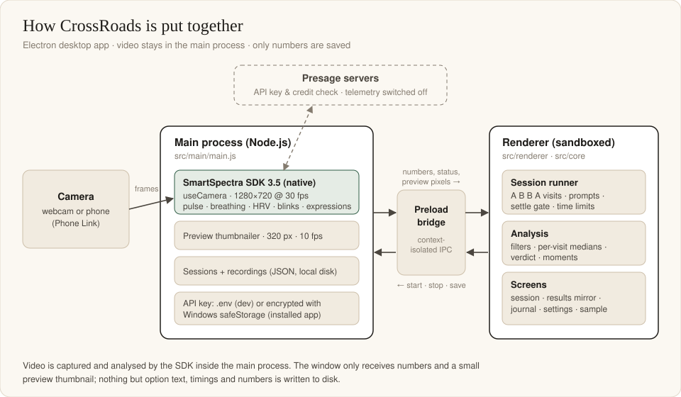
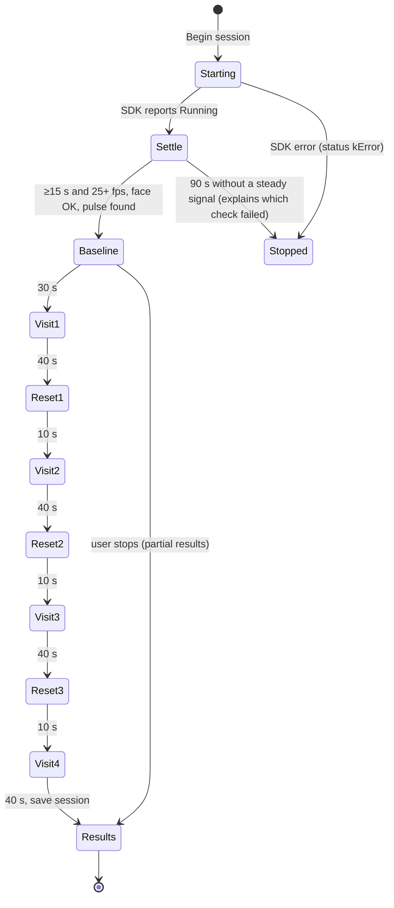
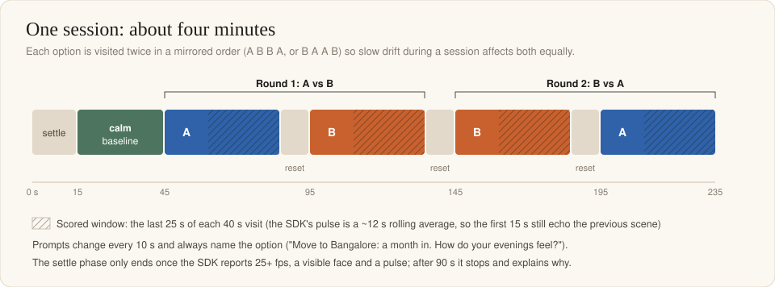
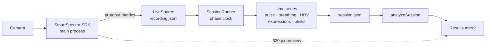
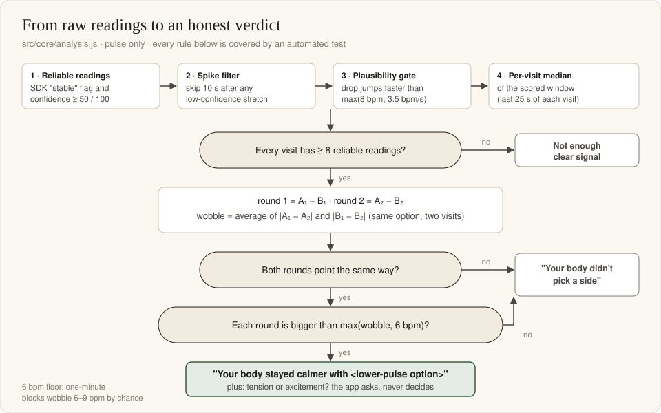

# Architecture

How CrossRoads is built, why it is built that way, and what is verified.

## Contents

- [Process model](#process-model)
- [Module map](#module-map)
- [Session state machine](#session-state-machine)
- [Data flow](#data-flow)
- [Data formats](#data-formats)
- [IPC surface](#ipc-surface)
- [Security model](#security-model)
- [Packaging](#packaging)
- [Design decisions](#design-decisions)
- [Verified vs not verified](#verified-vs-not-verified)

## Process model

CrossRoads is an Electron 45 app with three parts:

| Part | Runs | Responsibilities |
|---|---|---|
| **Main process** | Node.js | Owns the SmartSpectra SDK and the camera (`useCamera`), throttles a 320 px preview, writes sessions and recordings, stores the API key (Windows `safeStorage`), exposes a narrow IPC API |
| **Preload bridge** | isolated context | `contextBridge` exposes `window.gutCheck` (SDK controls, recordings, sessions, settings) and nothing else |
| **Renderer** | sandboxed Chromium window | Session runner, analysis, all screens. No Node access, strict CSP (`default-src 'self'`) |

The SDK runs **in the main process** because the SDK's other Electron mode (renderer `MediaStream` → main via `MessagePort`) copies a full-HD RGBA frame (~3.6 MB) per frame; on the development laptop only 10 frames/s got through and the SDK stopped itself (`kSustainedLowFrameRate`). Native capture in the main process delivers a steady 30 fps. See [SDK-NOTES.md](SDK-NOTES.md#1-run-the-sdk-in-the-main-process).

## Module map

| File | Contract |
|---|---|
| [`src/main/main.js`](../src/main/main.js) | Window, SDK lifecycle (`ensureSdk`, `destroySdk`), camera selection, preview thumbnailer, recordings/sessions on disk, settings (key, data folder, delete), dev-only test hooks |
| [`src/preload/preload.js`](../src/preload/preload.js) | The only API the window can call (`window.gutCheck`) |
| [`src/core/metrics.js`](../src/core/metrics.js) | Which SDK metrics are requested: breathing (chest, abdomen, rate), pulse, HRV, blinking, expressions |
| [`src/core/sources.js`](../src/core/sources.js) | `LiveSource` (SDK events, streams the raw recording to disk every 2 s) and `ReplaySource` (plays a recording back with the same events) |
| [`src/core/vitals.js`](../src/core/vitals.js) | Decodes SDK protobuf packets into pulse, breathing, HRV, expression scores, blinks; `BlinkCounter` de-duplicates overlapping packets |
| [`src/core/session.js`](../src/core/session.js) | `buildPlan` (A B B A visits, prompts) and `SessionRunner` (phase clock, settle gate, time limits, time-series collection, scripted replay) |
| [`src/core/analysis.js`](../src/core/analysis.js) | Reading filters, per-visit medians, the verdict rule, reaction moments. A pure function of the saved session JSON |
| [`src/renderer/app.js`](../src/renderer/app.js) | All screens: welcome, options, consent, camera check, session, results, my decisions, settings, sample |
| [`src/renderer/timeline.js`](../src/renderer/timeline.js) | The pulse-over-time SVG chart with hover tooltips |
| [`src/renderer/camera-name.js`](../src/renderer/camera-name.js) | Shows phone cameras without the owner name Windows adds |
| [`src/renderer/lab.*`](../src/renderer/lab.js) | Signal Lab: developer page for raw signals, short tests and raw replays |
| [`scripts/`](../scripts) | `build.js` (esbuild bundles), `start.js` (launch), `analyze-session.js` (prints any session's analysis), `make-icon.js` |
| [`tests/`](../tests) | 26 automated tests (`node --test`), run on every push by GitHub Actions |

## Session state machine

Visits follow `A B B A` or `B A A B`, chosen at random. A hard cap (planned length + 90 s settle + 60 s) guarantees a live session can never keep spending credits.

## Data flow

The analysis only ever reads the saved session JSON, so the same function powers the live result, My decisions, the bundled sample and `npm run analyze`.

## Data formats

**Recording** (`recordings/session-*.jsonl`): one JSON object per line, appended every 2 s.

| `type` | Fields |
|---|---|
| `meta` | `version`, `startedAt`, `mode`, `requestedMetrics`, `camera.name` |
| `metrics` | `t` (ms since start), `ts` (SDK µs), `b64` (raw protobuf packet) |
| `validation` | `t`, `code`, `ts`, `hint` |
| `status` / `error` | SDK processing status; error `code`, `message`, `retryable` |
| `fps` | frames sent/dropped in the last second |
| `mark` | phase changes: `kind`, `optionIndex`, `visit` |

Raw packets are stored so any recording can be re-decoded and re-analysed later with improved code.

**Session** (`sessions/gutcheck-*.json`):

| Field | Meaning |
|---|---|
| `version`, `createdAt`, `completed` | format version 2, timestamp, whether all 4 visits finished |
| `options` | the two options (`label`, optional `detail`) |
| `order` | visit order, e.g. `[1, 0, 0, 1]` |
| `timing` | phase lengths used |
| `phases[]` | `kind`, `optionIndex`, `visit`, `prompts`, `startMs`, `endMs` |
| `series` | `pulse[{t,v,c,s}]`, `breathing[…]`, `hrv[…]`, `expression[{t,scores}]`, `blinks[t]`, `fps[…]`, `validation[…]` |
| `recording` | the paired raw recording file |
| `choice` | optional: what the person decided later (`optionIndex`, `note`, `at`) |

## IPC surface

Everything the window can do, and nothing more:

| Channel | Purpose |
|---|---|
| `sdk:info`, `sdk:cameras`, `sdk:setCamera` | SDK version, key present, camera discovery and selection |
| `sdk:start`, `sdk:stop`, `sdk:destroy`, `sdk:readiness` | measurement lifecycle |
| `sdk:event`, `sdk:preview` | main → window: SDK events, preview pixels |
| `recording:begin`, `recording:append` | stream the raw recording |
| `session:save`, `session:list`, `session:read`, `session:setChoice`, `session:delete` | My decisions (the saved list) |
| `sample:read` | the bundled sample session |
| `settings:get`, `settings:saveKey`, `settings:removeKey` | API key (encrypted) |
| `data:openFolder`, `data:deleteAll` | data folder and deletion |

File names coming from the window are reduced to `path.basename` and checked for the expected extension, so the window cannot read or delete files outside the data folders.

## Security model

| Concern | Measure |
|---|---|
| Window compromise | `contextIsolation: true`, `sandbox: true`, no Node in the renderer, CSP `default-src 'self'` |
| API surface | one preload API; no generic file or shell access |
| Path traversal | basename + extension checks on every file IPC |
| API key | never in the repo; `.env` only in development; installed app encrypts it with Windows `safeStorage` (DPAPI) |
| Installer contents | packaging allow-list (`src`, `dist`, `assets`, `samples`); scanned for the key and for personal data before release |
| Electron fuses | `RunAsNode`, `NODE_OPTIONS` and `--inspect` disabled in the packaged app |
| Test hooks | `GUTCHECK_AUTOREPLAY` / `GUTCHECK_SHOTS` ignored when packaged |
| SDK telemetry | `enableTelemetry: false` |

## Packaging

`npm run dist` builds `release/CrossRoads-Setup-<version>.exe` (per-user NSIS installer) and a portable exe with electron-builder.

- **`asar: false`**: the SDK loads its native DLLs (`smartspectra_capi.dll`, OpenCV, Vulkan) through FFI from real file paths, which an asar archive would break.
- Only the Windows SDK runtime is shipped (the macOS and Linux runtimes, ~245 MB, are excluded).
- The installed app stores data in `%APPDATA%\crossroads` instead of its read-only install folder.

## Design decisions

1. **SDK in the main process, native capture.** 30 fps instead of 10; see above.
2. **Two options, each visited twice (A B B A).** One visit per option let session drift masquerade as a preference (the second option always came out higher). Mirrored order cancels linear drift.
3. **Compare options with each other, not with the baseline.** Imagining your life is always more arousing than the neutral tea scene, so "versus baseline" coloured every option tense.
4. **Pulse only for the verdict.** Breathing has a 30 s lag (longer than the useful part of a visit), HRV never became reliable (confidence ~10/100), expressions drifted with light and posture. They are shown, not voted.
5. **Medians, a 6 bpm floor, and agreement between rounds.** One-minute pulse blocks differ by 6–9 bpm by chance; see [VALIDATION.md](VALIDATION.md).
6. **"A mirror, not a verdict".** Results describe what the body did and ask questions; a calmer option is named only when the evidence is strong.
7. **Save raw packets.** Analysis improvements can be re-run on old sessions without new measurements (and without spending credits).
8. **Scripted sample replay.** The bundled sample replays on its recorded phase timing, so it always reproduces its real result instead of re-mixing data.

## Verified vs not verified

| Area | Status | Evidence |
|---|---|---|
| Verdict rules, spike filter, plausibility gate, moments | ✅ Verified (automated) | `tests/analysis.test.js` |
| Session plan (A B B A, timings, prompts) | ✅ Verified (automated) | `tests/session.test.js` |
| SDK packet decoding, blink de-duplication | ✅ Verified (automated) | `tests/vitals.test.js` |
| Null control says "didn't pick a side" | ✅ Verified (manual, Nov 12) | [VALIDATION.md](VALIDATION.md) |
| Positive control detects the calm option | ⚠️ Found once, not on the repeat (manual, Nov 12) | [VALIDATION.md](VALIDATION.md) |
| Installer: no key or personal data inside; SDK loads; live test; recording saved | ✅ Verified (manual, Nov 12) | [MANUAL-TESTS.md](MANUAL-TESTS.md) |
| Full 4-minute session in the installed app (CrossRoads 1.0.0) | ✅ Verified (manual, Nov 12, 5:45 PM) | [MANUAL-TESTS.md](MANUAL-TESTS.md) |
| Network traffic of the SDK (beyond key and credit checks) | ❌ Not verified | stated by Presage; not measured by us |
| macOS / Linux | ❌ Not built or tested | the SDK supports them; the installer is Windows-only |
| Accuracy of the SDK's pulse against a medical device | ❌ Not tested | out of scope; CrossRoads only compares a person with themselves |
