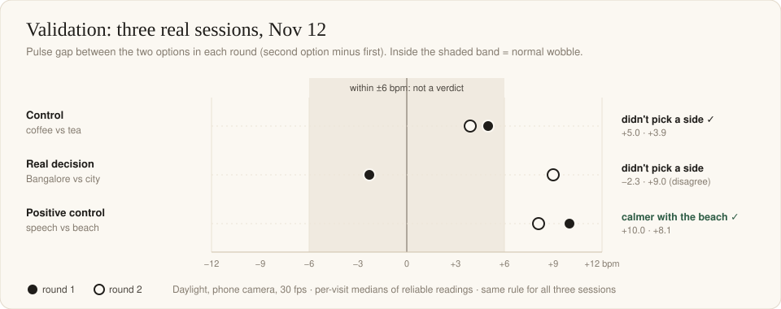
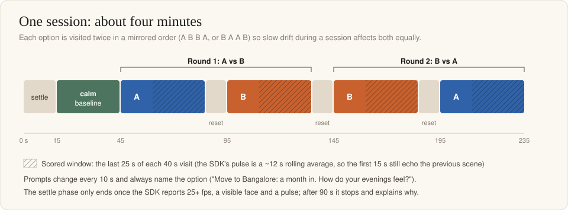
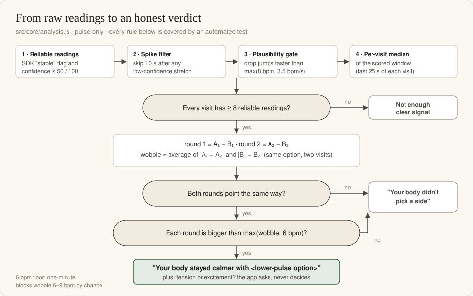

# Validation

**Can a webcam tell which of two options your body prefers?** We tried to fool our own app before trusting it. This file has every number, including the ones that went against us.



## Summary

| Session (Nov 12, daylight) | What should happen | Round 1 | Round 2 | CrossRoads said |
|---|---|---|---|---|
| **Control:** "drink tea" vs "drink coffee" | nothing to find | coffee +5.0 bpm | coffee +3.9 bpm | **Didn't pick a side** ✓ |
| **Real decision:** "stay in my city" vs "move to Bangalore" | unknown | Bangalore −2.3 | Bangalore +9.0 | **Didn't pick a side** (rounds disagree) |
| **Positive control, run 1:** "a quiet afternoon at the beach" vs "giving a speech to 1,000 people with no preparation" | a real reaction | speech +10.0 | speech +8.1 | **Calmer with the beach** ✓ |
| **Positive control, run 2** (same options, installed app, ~8 hours later) | a real reaction | speech +2.1 | speech −7.5 | **Didn't pick a side** (rounds disagree) |

| Session (Nov 14, daylight) | What should happen | Round 1 | Round 2 | CrossRoads said |
|---|---|---|---|---|
| **Real decision, repeated:** "stay in my city" vs "move to Bangalore" | unknown | Bangalore +0.3 | Bangalore −0.3 | **Didn't pick a side** (a true tie: 70.0 vs 70.0 bpm) |
| **Real decision:** "do a master's abroad" vs "start working after graduation" | unknown | work −2.1 | work +8.0 | **No clear winner** (rounds disagree), one moment stood out: +8.4 bpm at "what did you give up for it?" |
| **Real decision:** "tell my parents I want a different career" vs "keep going with the path they chose" | unknown | telling +10.7 | telling +9.4 | **Calmer with "keep going"** (both rounds beyond 6 bpm; says nothing about which is right) |

**What this shows, honestly:**
- The app **never invented a winner** in the three sessions where the evidence was weak or contradictory (control, real decision, positive control run 2). That is the property that matters most.
- It **found the calm option once** (run 1) but **not on a repeat** (run 2), even though run 2 had excellent signal quality. So a clear reaction is **not guaranteed to show up** in a four-minute session; the repeat is the more cautious, more honest data point.
- Four sessions from one person are encouraging about honesty, and a reminder about sensitivity. This is not a study.
- **Three more on Nov 14** (final build, same person): of the seven sessions in total the app named a calmer option twice (the beach, and a real career decision where both rounds agreed by about 10 bpm), and said "no clear winner" five times, including the tea-vs-coffee control. Most real decisions are mixed, which is why "didn't pick a side" has to be a respectable answer rather than a failure.

## 1. The first design failed its own control (Nov 11)

The first version visited each option **once** and compared it with a calm baseline. Two sessions at night:

| Session | Pulse gap (means) | Pulse gap (medians of reliable readings) |
|---|---|---|
| "drink tea" vs "drink coffee" (should be zero) | 8.0 bpm | 4.1 bpm |
| "stay in my city" vs "move to Bangalore" | 6.6 bpm | 2.0 bpm |

- The **control showed a bigger "difference" than the real decision**.
- In both sessions the option imagined **second** came out higher: the body drifts during a session, and one visit per option turns that drift into a fake preference.
- Every option looked more aroused than the baseline: imagining your own life is more stimulating than picturing a cup of tea.

**Conclusion:** single visits cannot tell options apart. The app was redesigned.

## 2. The redesign: ask twice

- Exactly two options, each visited **twice in a mirrored order** (A B B A or B A A B, chosen at random). Linear drift then affects both options equally.
- Options are compared **with each other**, never with the baseline.
- **Pulse only** for the verdict (see [SDK-NOTES.md](SDK-NOTES.md) for why breathing, HRV and expressions are not voted).
- Per visit: the **median** of reliable readings in the last 25 s of the 40 s visit.



## 3. Calibrating the threshold on real data

To find out how big a gap appears **by pure chance**, we cut the pulse series of the two night sessions into fake A-B-B-A sessions at many offsets, so the labels meant nothing (47 overlapping windows, one-minute blocks).

| Rule tested on the fake sessions | Fake "winners" |
|---|---|
| Both rounds agree and the average gap beats the visit-to-visit wobble | 87% |
| Both rounds agree and each beats the wobble | 81% |
| Both rounds agree and the average gap beats twice the wobble | 81% |
| Both rounds agree, each beats the wobble, and the gap is ≥ 5 bpm | 72% |
| **Both rounds agree and each beats max(wobble, 6 bpm)** | **26%** |

Gaps between meaningless blocks were 6.4 bpm (median), 8.4 bpm (90th percentile), up to 9.1 bpm. **A resting pulse wobbles 6–9 bpm from minute to minute by itself.** CrossRoads uses the strictest rule, and even it would fake a winner about one time in four on this (pessimistic, overlapping) data. That is why the product is **a mirror, not a verdict**: the results show what the body did, and a calmer option is named only when the evidence is strong.

The rule, as implemented in [`src/core/analysis.js`](../src/core/analysis.js):



## 4. The validation sessions (Nov 12 and Nov 14)

Setup: daylight from a window, Samsung phone as the camera through Windows Phone Link (steady 30 fps), sitting back, reading prompts silently.

**Per-visit medians** (bpm, reliable readings in brackets):

| Session | Order | A₁ | B₁ | A₂ | B₂ | Wobble | Verdict |
|---|---|---|---|---|---|---|---|
| Control (A = tea, B = coffee) | A B B A | 61.0 (26) | 66.0 (26) | 63.8 (27) | 67.7 (29) | 2.2 | didn't pick a side |
| Real (A = city, B = Bangalore) | B A A B | 62.1 (27) | 59.8 (15) | 61.6 (26) | 70.6 (31) | 5.7 | didn't pick a side |
| Positive (A = beach, B = speech) | B A A B | 73.9 (13) | 83.9 (9) | 69.7 (14) | 77.9 (20) | 5.1 | calmer with the beach |

**Signal quality:**

| Session | Pulse readings | Marked stable | Mean confidence |
|---|---|---|---|
| Control | 251 | 94% | 81 / 100 |
| Real decision | 247 | 94% | 79 / 100 |
| Positive control | 284 | 75% | 56 / 100 |

Notes:

- In the control, tea was lower in both rounds (by 5.0 and 3.9 bpm). A looser rule would have announced "calmer with tea"; the 6 bpm floor correctly refused.
- The positive control had weaker signal; its first speech visit kept 9 reliable readings (the minimum is 8). The verdict is valid but close to the data-quality edge.
- The real decision's rounds pointed in opposite directions. "Didn't pick a side" is the honest answer, not a failure.

### Nov 14: three real decisions on the final build

Same setup (daylight, phone camera, 30 fps), same person, about 15 minutes apart with rest between.

| Session | Order | A₁ | B₁ | A₂ | B₂ | Stable readings | Verdict |
|---|---|---|---|---|---|---|---|
| City (A) vs Bangalore (B) | B A A B | 69.1 (12) | 69.5 (9) | 70.8 (8) | 70.5 (13) | 79% | didn't pick a side |
| Master's (A) vs work (B) | B A A B | 69.8 (29) | 67.8 (9) | 69.3 (27) | 77.3 (27) | 92% | no clear winner |
| Telling parents (A) vs keep going (B) | A B B A | 70.5 (30) | 59.8 (11) | 65.8 (28) | 75.3 (28) | 87% | calmer with "keep going" |

(Each cell: median pulse in bpm, reliable readings in brackets.)

- The city-vs-Bangalore repeat landed on **70.0 vs 70.0 bpm**, the clearest tie we have. The first run on Nov 12 had also been a tie, for a different reason (rounds in opposite directions).
- In the master's session the rounds disagreed, but the pulse rose 8.4 bpm at one question, so the result leads with that moment, as a question rather than proof (one moment can be chance, and the tea-vs-coffee control had one too). A tie screen therefore only promotes a moment of 6 bpm or more.
- The parents session is the only real decision where both rounds agreed beyond the 6 bpm floor. A lower pulse while imagining the familiar path is not evidence it is the right path: the app asks "which was it, tension or excitement?"
- One visit in the city session kept exactly 8 reliable readings (the minimum), so it is close to the data-quality edge.

The first positive control (run 1) is bundled with the app as the [sample session](../samples/beach-vs-speech) (camera name removed). Anyone can check its numbers:

```bash
npm run analyze
```

### Positive control, run 2 (installed CrossRoads 1.0.0, same options)

Same two options, same person, the installed app, at 5:45 PM (run 1 was at 10:00 AM). Signal quality was **better** than run 1:

| | Run 1 | Run 2 |
|---|---|---|
| Pulse readings | 284 | 272 |
| Marked stable | 75% | 98% |
| Mean confidence | 56 / 100 | 83 / 100 |
| Reliable readings per visit | 9–20 | 29–31 |
| Frame rate | 30 fps | 30 fps |

**Per-visit medians** (order A B B A; A = beach, B = speech):

| A₁ (beach) | B₁ (speech) | B₂ (speech) | A₂ (beach) | Round 1 (speech − beach) | Round 2 (speech − beach) | Wobble | Verdict |
|---|---|---|---|---|---|---|---|
| 69.9 (29) | 72.0 (30) | 70.4 (30) | 77.9 (31) | +2.1 | −7.5 | 4.8 | didn't pick a side |

The reaction did not repeat: speech was only 2 bpm higher in round 1, and the second beach visit was the **highest** of the four (77.9). The strongest single "moment" was +8.2 bpm during the second speech visit's *"you tell a close friend how it went"* prompt.

**Possible explanations (hypotheses, not tested):**
- *Novelty.* On run 1 the scenes were new and the tension real; on run 2 the person knew the scenes and the expected result.
- *Prompt templates.* Second-visit prompts are shared across options ("what did you give up for it?", "one hard day, how do you handle it?"). That wording can raise tension even in a calm beach scene, which would blur a calm-vs-stressful contrast.
- *Ordinary wobble.* One-minute pulse blocks differ by 6–9 bpm by chance; a 7.5 bpm swing between two visits of the same scene is within that.

**What we changed because of it:** nothing in the rule. A rule that says "didn't pick a side" when two clean rounds disagree is behaving as designed. We did change the claims: the README and the post now say the positive control was found once and not on the repeat.

## 5. What changed because of the data

| Finding | Change |
|---|---|
| Single visits confuse drift with preference | A B B A design |
| One-minute blocks wobble 6–9 bpm by chance | 6 bpm floor + both rounds must agree |
| After a low-confidence stretch the SDK reported ~93–97 bpm for a person resting at ~62–78, sometimes flagged "stable" | readings in the 10 s after a low-confidence stretch are ignored |
| Occasional physically impossible jumps | plausibility gate: max(8 bpm, 3.5 bpm/s); re-checked that no real verdict changed |
| At night a neutral face read "sad" 80–95%; in daylight 86–92% "neutral" | expressions are timeline-only; the app asks for front light |
| HRV appeared only after ~60 s with confidence ~10 | HRV removed from the results |
| Breathing is only readable in the last ~10 s of a visit (30 s lag). With a "1 breath/min in both rounds" rule it picked a side in the tea-vs-coffee control (tea), and in the beach sample it pointed the opposite way to pulse | breathing is shown per visit as numbers, never voted, and never summarised as "agreed" or "disagreed" |
| 6-minute sessions were uncomfortable and overheated the phone camera | 4-minute sessions (30 s baseline, 40 s visits, 10 s resets) |

## 6. Limits

- **One person, four validation sessions.** Not a study. A real evaluation would need many people and repeated sessions.
- **The positive control did not replicate.** Found once (run 1), not on the repeat (run 2). Sensitivity to a real reaction is limited and varies between sessions; CrossRoads is built to say so rather than guess.
- **Prompts are generic templates** shared across options, so a calm scene can still be asked a tense question. Tailoring them is future work.
- **The 26% figure is rough**: two source sessions, overlapping windows, an earlier block length.
- **Pulse is a ~12 s rolling average from the SDK.** CrossRoads cannot see second-by-second reactions; "moments" are reflection cues within normal wobble, not measurements.
- **A higher pulse is not "worse".** Excitement and fear both raise it; the app asks which it was.
- **Not a medical device** and no accuracy claims against clinical equipment. CrossRoads only compares a person with themselves within one session.
